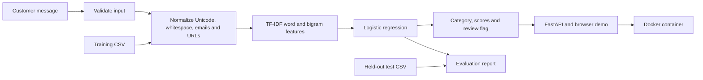

# About

A small end-to-end Python machine-learning service that suggests a support queue for a customer message and flags low-scoring predictions for human review. Includes a browser demo, REST API, reproducible training, held-out evaluation, tests, and container deployment configuration.

**Status:** working local portfolio project. Synthetic demonstration data, not a validated production classifier. No paid API or API key required. Uses a trained statistical model, not an LLM.

## The complete flow



The four categories are `billing`, `account`, `cancellation`, and `technical`. A message such as “I was charged twice” should go to billing. The model suggests a category even when it asks for review; callers should respect `needs_review` before routing automatically.

## Run locally

Use Python 3.14. From this repository's root:

```bash
python3 -m venv .venv
source .venv/bin/activate
python -m pip install -r requirements-dev.txt
python -m triage.train
python -m pytest -q
python -m uvicorn triage.api:app --host 127.0.0.1 --port 8000
```

Open <http://localhost:8000> for the demo or <http://localhost:8000/docs> for interactive API documentation. The model must be trained before starting the server. Stop it with Ctrl+C.

```bash
curl http://localhost:8000/predict \
  -H 'Content-Type: application/json' \
  -d '{"text":"I was charged twice for my subscription"}'
```

Responses include `category`, `score`, `scores`, `needs_review`, `reason`, and `model_version`. `GET /health` confirms the model was loaded. Invalid input returns HTTP 422. The service loads its model once at startup and fails immediately if the artifact is missing.

## Files to understand

| File | Responsibility |
| --- | --- |
| `data/train.csv`, `data/test.csv` | 80 training and 24 separately authored test tickets |
| `data/README.md` | Dataset origin, label definitions and limitations |
| `triage/model.py` | Shared preprocessing, feature/model pipeline and review policy |
| `triage/train.py` | Validate data, train, persist and evaluate |
| `triage/api.py` | Request validation, model loading and HTTP endpoints |
| `static/index.html` | Small browser demo |
| `reports/evaluation.json` | Measured metrics, confusion matrix and mistakes |
| `tests/test_project.py` | API, validation, split integrity and persistence checks |
| `Dockerfile` | Build a container including its trained model |
| `.github/workflows/ci.yml` | Train, test, build image and smoke-test the container |
| `docs/interview-guide.md` | Architecture explanation, decisions and honest limitations |

## Measured demo results

On the 24 synthetic held-out examples: **91.7% accuracy**, **0.916 macro-F1**, versus **25% accuracy** for the majority-class baseline. The 0.55 review threshold accepts 12 of 24 tickets; those 12 are correct in this tiny test. This is not evidence of 100% reliability in production. The full report includes the two classification errors.

Local verification: 15 tests passed. One upstream deprecation warning recommends a newer test client transport; it does not affect the passing checks.

## Why this model?

TF-IDF represents words and two-word phrases as numeric features. Logistic regression learns a weight for each feature and class. This is an inexpensive, explainable starting point for a narrow classification task. No language model provider, GPU, network inference or prompt is required. The scikit-learn pipeline fits the vocabulary only on training data and saves preprocessing with the classifier, preventing a common train/serve mismatch.

## Evaluation

Run `python -m triage.train` to regenerate `reports/evaluation.json`. It contains accuracy, macro-F1, per-class precision/recall, a confusion matrix (rows=true, columns=predicted), errors, and a most-frequent-class baseline. It also reports automation coverage and accuracy on accepted predictions, so review policy is visible rather than hidden behind an accuracy score.

The illustrative review threshold is 0.55, specified before evaluation; it was not optimized on the test set. Scores are **not calibrated probabilities of correctness**. Inputs with no known tokens always require review. Other out-of-domain inputs may still be confidently misclassified.

The data is small, balanced, synthetic and easy. These results establish a working pipeline, not customer-data performance. There is no independent validation set for tuning. Before experimenting with model selection, add a validation split and preserve an untouched test set. Dataset hashes and library version are recorded for traceability; `model_version` combines a manually maintained pipeline revision and training-data hash. Bump the revision when changing the model or preprocessing.

## Deploy with Docker

Install Docker, then from the repository root:

```bash
docker build -t ticket-triage .
docker run --rm -p 8000:8000 --name ticket-triage ticket-triage
```

Open <http://localhost:8000>, then verify `/health` and `/predict`. The image installs pinned dependencies, trains its model during the build, runs as a non-root user, and listens on port 8000. Configure a container hosting service with port 8000 and `/health` as its health-check path. No persistent volume is required. Rebuild the image to deploy new data or model code; retain the previous image for rollback.

Docker is not installed in the authoring environment, so the container build was not verified locally. The included GitHub workflow performs that check when pushed. A hosted deployment has not been created. For public use, add an authenticated gateway, request-size/rate limits and HTTPS; measure latency, errors, review rate and label drift. Normalization replaces emails and URLs but is not comprehensive personal-data removal. The app does not store ticket text; configure hosting logs accordingly. Only load model artifacts you built yourself: joblib uses pickle-compatible deserialization.

## Put it on GitHub

Create an empty GitHub repository named `ticket-triage`, then run from this folder (replace `YOUR_USERNAME`):

```bash
git init -b main
git add .
git commit -m "Build end-to-end support ticket triage service"
git remote add origin https://github.com/YOUR_USERNAME/ticket-triage.git
git push -u origin main
```

The environment and generated model binary are ignored; source data, reports and pinned dependencies are included. The CI workflow retrains the model and checks the application. This project has not yet been uploaded to GitHub.

## Technical references

- [scikit-learn TF-IDF documentation](https://scikit-learn.org/stable/modules/generated/sklearn.feature_extraction.text.TfidfVectorizer.html)
- [scikit-learn logistic regression](https://scikit-learn.org/stable/modules/generated/sklearn.linear_model.LogisticRegression.html)
- [FastAPI container deployment](https://fastapi.tiangolo.com/deployment/docker/)
